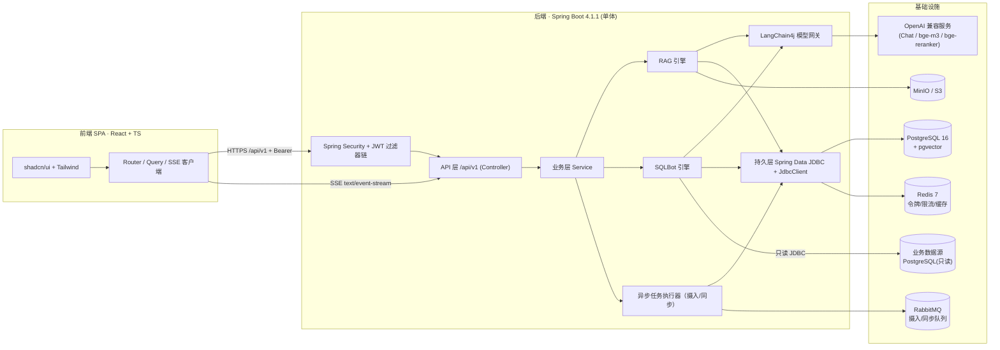
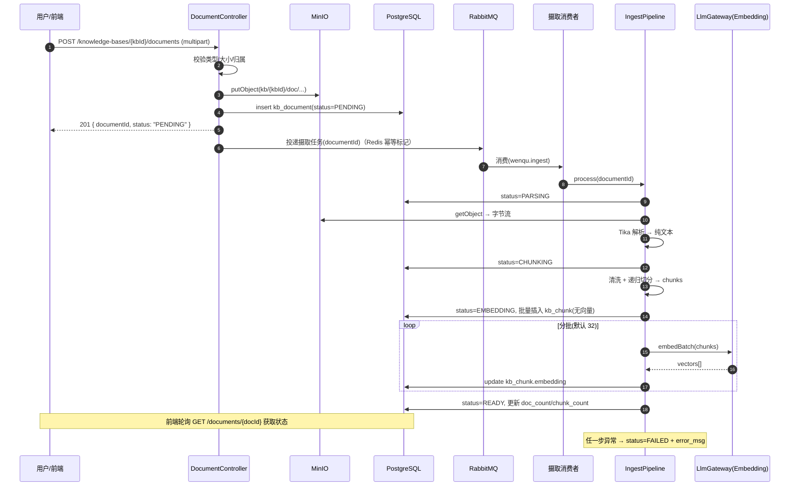
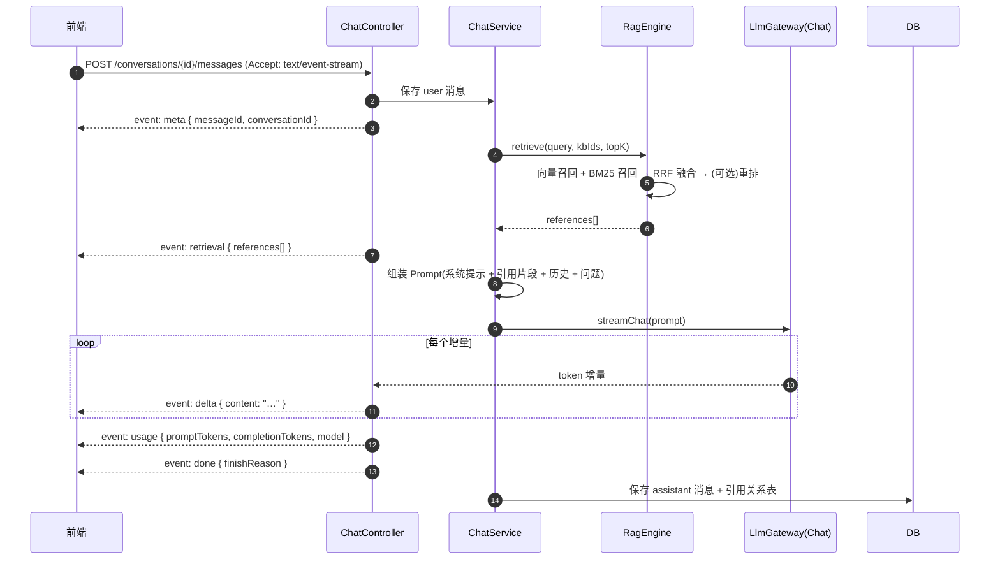
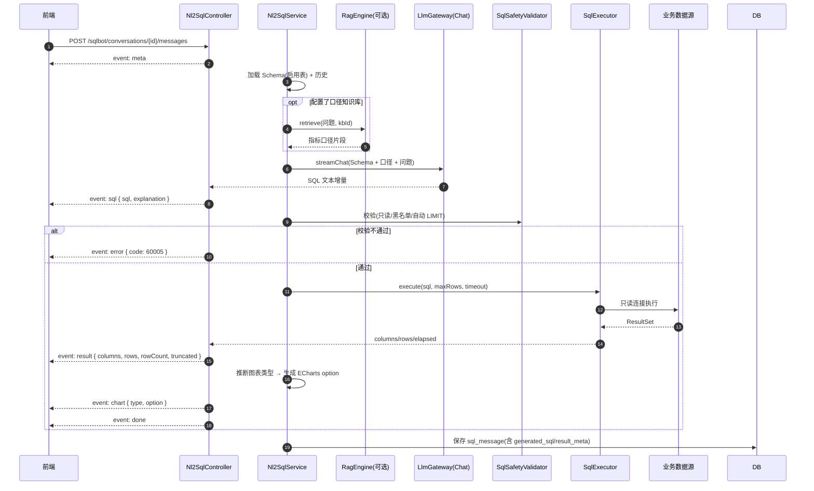
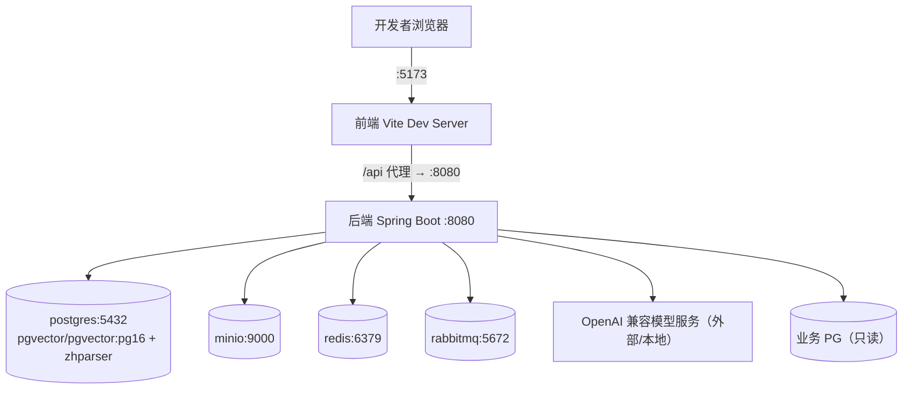

# 02 · 技术架构设计

> 返回 [索引](./README.md) · 上一篇 [需求与范围](./01-需求与范围说明.md) · 下一篇 [数据库设计](./03-数据库设计.md)

---

## 1. 总体架构



**架构要点**

1. **单体分层**：本期不做微服务。按 `modules` 包内高内聚拆分，未来可按模块抽离。
2. **模型网关**：所有大模型调用统一经过 `LlmGateway`（基于 LangChain4j），屏蔽多供应商差异；
   支持超时、重试、降级（Chat 失败可回落备用模型）。
3. **两条引擎**：`RagEngine` 与 `SqlEngine` 互不依赖业务细节，仅通过 `LlmGateway` 与 `Repository` 交互。
   二者的组合点是 `SqlEngine` 可选调用 `RagEngine.retrieve()` 获取指标口径。
4. **SSE 直连**：对话类接口使用 `POST + text/event-stream`，由 WebMvc 的 `SseEmitter`/`StreamingResponseBody` 提供；
   不走 WebSocket，降低复杂度。
5. **异步任务**：文档摄入与 Schema 同步为长任务，投递到 **RabbitMQ**（队列 `wenqu.ingest`、`wenqu.schema-sync`），
   消费者处理并推进 `kb_document.status` 等 DB 状态机，前端轮询状态接口。生产者仅负责投递与幂等标记（Redis）。
6. **热状态**：Refresh Token 吊销、登录失败计数、系统参数缓存走 **Redis**；多实例部署下状态一致。

---

## 2. 技术选型清单

| 类别 | 选型 | 版本 | 说明 |
|---|---|---|---|
| 语言 | Java | 17 | 与现有 `pom.xml` 一致（Spring Boot 4 基线为 17） |
| 框架 | Spring Boot | 4.1.1 | 已存在于 `backend/pom.xml` |
| Web | `spring-boot-starter-webmvc` | — | Boot 4 的 starter 命名 |
| 安全 | `spring-boot-starter-security` | — | JWT 无状态 |
| 持久层 | `spring-boot-starter-data-jdbc` | — | **不使用 JPA/Hibernate**；复杂 SQL 用 `JdbcClient` |
| 数据库 | PostgreSQL | 16+ | 主库 |
| 向量扩展 | pgvector | 0.7+ | `vector` 类型、HNSW 索引 |
| 中文分词 | zhparser / pg_jieba（可选） | — | 中文 BM25 用，见风险表 |
| 迁移 | Flyway（建议引入） | 10.x | 见 [`06`](./06-待确认事项.md) |
| 对象存储 | MinIO Java SDK | 8.5.x | S3 兼容 |
| 缓存/令牌 | Redis 7 + Spring Data Redis | 7.x | 吊销黑名单、登录限流、配置缓存 |
| 消息队列 | RabbitMQ + Spring AMQP | 3.13 / 3.x | 文档摄入、Schema 同步、任务重试 |
| 大模型 | LangChain4j | 1.x | 直接用 `langchain4j-openai` 等模块，**不用其 Spring Boot Starter**（避免与 Boot 4 冲突） |
| 文档解析 | Apache Tika | 2.x/3.x | PDF/DOCX/MD/TXT/HTML |
| 参数校验 | `spring-boot-starter-validation` | — | 建议补充引入 |
| 接口文档 | springdoc-openapi | — | 建议引入，扫描 `/api/v1` |
| 连接池 | HikariCP | 内置 | 主库 + 动态数据源各一套 |
| 工具 | Lombok | — | 已在 pom 中 |
| 前端 | React 18 + TypeScript + Vite | — | |
| UI | shadcn/ui + Tailwind CSS | — | |
| 图表 | ECharts | 5.x | SQLBot 结果可视化 |

> ⚠️ **LangChain4j 与 Spring Boot 4 的兼容性**是首要技术风险，见第 6 节。

---

## 3. 后端模块划分

### 3.1 包结构

```
xyz.cbt.wenqu.backend
├── WenquApplication.java
├── common/                         # 无业务依赖的通用能力
│   ├── api/        ApiResponse, PageResult, ErrorCode, BizException, GlobalExceptionHandler
│   ├── constant/   RedisKeyConstant(占位), SecurityConstant, FileConstant
│   ├── util/       CryptoUtil(AES-GCM), IdUtil, IpUtil, TokenCountUtil
│   └── enums/      RoleEnum, ModelTypeEnum, DocStatusEnum, RetrievalModeEnum, ChartTypeEnum ...
├── config/
│   ├── SecurityConfig              # 过滤器链、白名单、CORS、密码编码器
│   ├── JwtProperties               # secret / access-ttl / refresh-ttl
│   ├── MinioConfig                 # MinioClient Bean + 桶初始化
│   ├── LlmGatewayConfig            # 模型注册表（按 llm_model 表动态构建）
│   ├── AsyncConfig                 # 摄入线程池、Schema 同步线程池
│   ├── OpenApiConfig
│   └── WebMvcConfig                # 拦截器、消息转换器、SSE 超时
├── security/
│   ├── JwtTokenProvider            # 签发/解析/校验
│   ├── JwtAuthenticationFilter     # 从 Header 解析并写入 SecurityContext
│   ├── UserPrincipal               # 认证主体（userId/username/role）
│   ├── SecurityUtils               # 取当前用户
│   ├── ResourceGuard               # owner 归属校验（USER 只能操作自己的资源）
│   └── annotation/  @RequireRole, @RequireOwner
└── modules/
    ├── auth/          AuthController, AuthService, dto/
    ├── user/          UserController, UserService, dto/, entity/
    ├── model/         LlmModelController, LlmModelService, LlmGateway, dto/, entity/
    ├── knowledgebase/
    │   ├── KnowledgeBaseController / Service
    │   ├── DocumentController / DocumentService
    │   ├── ChunkController / ChunkService
    │   ├── RetrievalController / RetrievalService     # 检索测试
    │   ├── ingest/    IngestPipeline, TikaParser, TextCleaner, RecursiveSplitter, EmbeddingIndexer
    │   └── retrieve/  VectorSearcher, Bm25Searcher, RrfFuser, Reranker
    ├── chat/          ChatController, ChatService, SsePublisher, dto/, entity/
    ├── sqlbot/
    │   ├── DatasourceController / Service, ConnectionTester, DynamicDataSourceManager
    │   ├── SchemaController / SchemaSyncService
    │   ├── Nl2SqlController / Nl2SqlService, SqlGenerator, SqlSafetyValidator, SqlExecutor
    │   ├── SqlChartAdvisor                                    # 结果 → ECharts option 建议
    │   └── export/    CsvExporter, ExcelExporter
    └── system/        SettingController / Service, OperationLogController / Service, DashboardController
```

### 3.2 模块依赖关系

- `common`、`config`、`security` 被所有模块依赖，自身不依赖业务模块。
- `chat` 依赖 `knowledgebase`（检索）与 `model`（网关）。
- `sqlbot` 依赖 `knowledgebase`（可选，取口径）、`model`（网关）；**不依赖** `chat`。
- `knowledgebase` 依赖 `model`、`common`。
- 严禁反向依赖（如 `knowledgebase` 依赖 `chat`）。

---

## 4. 关键流程时序

### 4.1 文档摄入（异步流水线）



### 4.2 RAG 问答（SSE 流式）



### 4.3 NL2SQL 查询（SSE 流式）



---

## 5. 关键技术方案

### 5.1 统一响应与异常

- 所有 Controller 返回 `ApiResponse<T>`；`PageResult<T>` 承载分页。
- 业务异常抛 `BizException(ErrorCode)`；`@RestControllerAdvice` 统一兜底并记录 `traceId`。
- 参数校验失败由 `MethodArgumentNotValidException` 处理为 `10001`。

### 5.2 认证鉴权

- Spring Security 过滤器链：`JwtAuthenticationFilter` 前置，`/api/v1/auth/login`、`/auth/refresh`、
  健康检查、OpenAPI 白名单放行，其余 `authenticated()`。
- 方法级鉴权：`@PreAuthorize("hasAnyRole('ADMIN','SUPERADMIN')")` 控制管理类接口。
- 归属校验：Service 层调用 `ResourceGuard.checkOwner(resource)`（`@RequireOwner` AOP 或显式调用）。

### 5.3 模型网关（多模型可配置）

- `llm_model` 表是唯一事实来源；启动时与运行中变更（增删改）都会刷新内存注册表 `ModelRegistry`。
- `LlmGateway` 暴露统一方法：

```java
public interface LlmGateway {
    String chat(String modelKey, List<ChatMsg> messages, ChatOptions opts);
    void streamChat(String modelKey, List<ChatMsg> messages, ChatOptions opts, Consumer<String> onDelta);
    List<float[]> embed(String modelKey, List<String> texts);
    List<Float> rerank(String modelKey, String query, List<String> docs);
}
```

- 底层使用 LangChain4j 的 `OpenAiChatModel` / `OpenAiEmbeddingModel` / `OpenAiStreamingChatModel`
  针对每个配置项构建并缓存实例（`baseUrl` + `apiKey` + `modelName`）。
- RERANK：`bge-reranker-v2-m3` **无 OpenAI 标准接口**，由 `RerankClient` 按供应商协议适配
  （约定请求 `{model, query, documents[], top_n}` → 返回 `{results:[{index, relevance_score}]}`）。
  检索管线固定为：**bge-m3 向量召回 → bge-reranker-v2-m3 精排**（`rerankEnabled=true` 时启用）。

### 5.4 混合检索

```
score_final = RRF( rank_vector, rank_bm25 )            # 默认
            ↑ 权重可调：vector_weight / bm25_weight（系统参数）
若开启重排： 以 RRF 结果的前 N（默认 20）作为候选，交给 RERANK 模型重排后取 TopK
```

- 两路召回各自 TopK（默认 20），再融合。
- SQL 层面：向量用 `embedding <=> :qvec`（余弦距离，`vector_cosine_ops`），
  BM25 用 `tsv @@ plainto_tsquery(...)` + `ts_rank_cd`。
- 过滤条件（kb_id、min_score、文档状态）下推到 SQL。

### 5.5 动态数据源（SQLBot）

- 不为每个数据源建 Spring 数据源 Bean（数量不可控），改用**每次连接新建 HikariDataSource 并缓存**的
  `DynamicDataSourceManager`（LRU + 空闲回收），或直接 `DriverManager` + 短连接。
  推荐前者（连接复用），配置 `maximumPoolSize` 取自数据源记录。
- 执行前设置：`connection.setReadOnly(true)`、`statement.setQueryTimeout(timeoutSec)`、`setMaxRows(maxRows+1)`。

### 5.6 SQL 安全校验

1. 去除注释与字符串字面量后，取首个关键字，必须 ∈ {SELECT, WITH, EXPLAIN}。
2. 全文匹配黑名单（可配置）：`DROP/TRUNCATE/DELETE/UPDATE/INSERT/ALTER/GRANT/REVOKE/CREATE`。
3. 禁止多语句（分号后仍有内容即拒绝）。
4. 无 `LIMIT` 时自动追加 `LIMIT maxRows+1`；外层包一层子查询以兼容已有 LIMIT。
5. 超过 `maxRows` 时截断并置 `truncated=true`。

### 5.7 文档解析与切分

- Tika `AutoDetectParser` + `BodyContentHandler` 抽纯文本；HTML 走 `HtmlMapper` 保留结构。
- 清洗：去页眉页脚噪声、合并多余空白、规范化换行。
- 切分：`RecursiveCharacterTextSplitter` 语义分隔符优先级 `["\n\n","\n","。","！","？","；"," ",""]`，
  以 **token** 计量（非字符），支持块大小与重叠。

### 5.8 对象存储约定

- 单桶 `wenqu`，对象键 `kb/{kbId}/doc/{yyyy}/{MM}/{uuid}.{ext}`；下载走预签名 URL（默认 10 分钟有效）。
- 删除文档时先删 DB 记录，再异步删对象；对象删除失败进重试表（见 [`06`](./06-待确认事项.md) 简化方案）。

---

## 6. 风险与对策

| 风险 | 影响 | 对策 |
|---|---|---|
| **LangChain4j 是否兼容 Spring Boot 4** | 阻塞模型接入 | 不依赖其 Spring Boot Starter，仅用核心与 provider 模块；先用最小 Demo 验证（见 [`05`](./05-开发文档.md) 任务 T0）；必要时隔离在 `LlmGateway` 后换成原生 HTTP 调用 |
| 中文 BM25 分词 | 影响混合检索质量 | 优先安装 `zhparser`/`pg_jieba`；不可安装则应用层分词后写 `tsv`，或降级为纯向量（系统参数可切换） |
| pgvector 维度固定 | 换 embedding 模型需重建索引 | 全局锁定维度；切换模型视为一次"全量重建"运维动作（计划任务 + 双写过渡） |
| SSE 在网关/代理下被缓冲 | 流式失效 | Nginx 关闭 `proxy_buffering`；响应头 `X-Accel-Buffering: no`；心跳保活 |
| 大模型超时/限流 | 对话与查数失败 | 网关层超时 + 重试 + 备用模型；错误以 SSE `error` 事件返回而非连接断开 |
| 动态数据源连接泄漏 | 拖垮应用 | 连接池缓存 + 空闲回收 + 强制超时；监控活跃连接数 |
| 长文本超上下文窗口 | 生成质量差 | Prompt 层按 token 预算裁剪引用片段；超出阈值减少 TopK |
| 消费者崩溃导致消息丢失 | 摄入卡死 | RabbitMQ 消息持久化 + 手动 ack；启动时扫描 `status in (PENDING,PARSING,CHUNKING,EMBEDDING)` 的文档重新入队；死信队列 `wenqu.ingest.dlx` |
| Redis 不可用 | 登录/限流失效 | 令牌校验降级为查 `sys_refresh_token`；限流降级为放行并打告警日志 |

---

## 7. 部署拓扑（开发/测试）



`docker-compose.yml` 建议提供 `postgres`（pgvector + zhparser）、`minio`、`redis`、`rabbitmq` 四个服务；
后端与前端在开发期本机运行。详见 [`05-开发文档.md`](./05-开发文档.md)。
