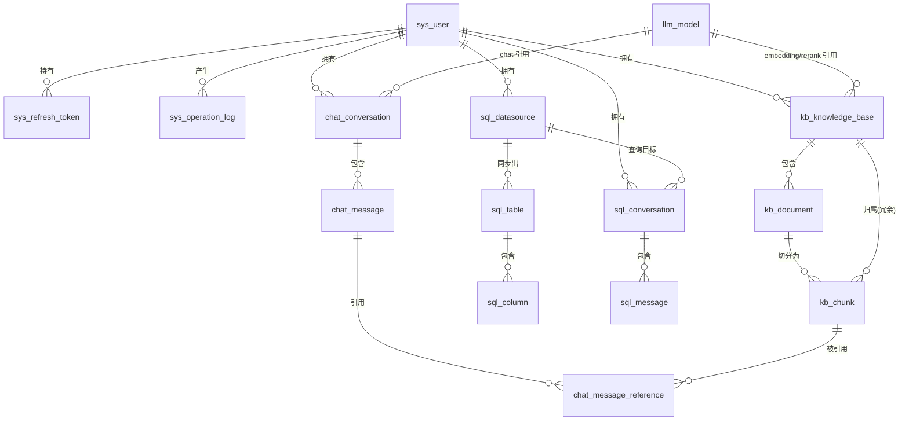

# 03 · 数据库设计

> 返回 [索引](./README.md) · 上一篇 [技术架构设计](./02-技术架构设计.md) · 下一篇 [API 接口规范](./04-API接口规范.md)
>
> 目标库：PostgreSQL 16+，扩展 `vector`（pgvector 0.7+）。
> 所有表使用 `bigint` 雪花/自增主键，统一带 `created_at` / `updated_at`（`timestamptz`）。
> 初始化脚本见本文末「附录 A：完整 DDL」，建议以 Flyway 迁移文件形式落地（`V1__init.sql`）。

---

## 1. 命名与通用约定

| 约定 | 说明 |
|---|---|
| 表名 | 小写下划线，模块前缀 `sys_` / `llm_` / `kb_` / `chat_` / `sql_` |
| 主键 | `id bigint generated by default as identity primary key` |
| 外键 | 显式声明 `ON DELETE CASCADE`（子资源）或 `RESTRICT`（被引用资源） |
| 时间 | `created_at timestamptz not null default now()`；`updated_at` 由触发器或应用维护 |
| 软删除 | **不使用**软删除（除特殊说明），删除即物理删除；审计由 `sys_operation_log` 承担 |
| 布尔 | `boolean` |
| 枚举 | 用 `varchar` + 应用层枚举 + `CHECK` 约束（避免 PG 原生 enum 的迁移成本） |
| JSON | `jsonb` |
| 密文 | `*_cipher text`（AES-GCM 加密后的 Base64），密钥来自应用配置 |

---

## 2. ER 关系总览



---

## 3. 表清单

| # | 表名 | 中文名 | 说明 |
|---|---|---|---|
| 1 | `sys_user` | 用户 | 账号主体，含角色 |
| 2 | `sys_refresh_token` | 刷新令牌 | 支持登出吊销 |
| 3 | `sys_login_attempt` | 登录尝试 | 失败计数与锁定 |
| 4 | `sys_operation_log` | 操作日志 | 审计 |
| 5 | `sys_setting` | 系统参数 | 键值配置 |
| 6 | `llm_model` | 模型配置 | 多供应商 |
| 7 | `kb_knowledge_base` | 知识库 | |
| 8 | `kb_document` | 文档 | 含摄入状态机 |
| 9 | `kb_chunk` | 分片 | 含 `embedding vector` 与 `tsv` |
| 10 | `kb_retrieval_log` | 检索日志 | 检索测试与问答的召回记录（可选，用于评估） |
| 11 | `chat_conversation` | 问答会话 | |
| 12 | `chat_message` | 问答消息 | |
| 13 | `chat_message_reference` | 消息引用 | 回答与分片的关联 |
| 14 | `sql_datasource` | 数据源 | |
| 15 | `sql_table` | 表元数据 | Schema 同步结果 |
| 16 | `sql_column` | 字段元数据 | |
| 17 | `sql_conversation` | 查数会话 | |
| 18 | `sql_message` | 查数消息 | 含生成的 SQL 与结果元信息 |

---

## 4. 各表字段说明（要点）

### 4.1 `sys_user`

| 字段 | 类型 | 约束 | 说明 |
|---|---|---|---|
| id | bigint | PK | |
| username | varchar(64) | UNIQUE NOT NULL | 登录名，小写 |
| password_hash | varchar(100) | NOT NULL | BCrypt |
| nickname | varchar(64) | | 显示名 |
| email | varchar(128) | | 可选 |
| role | varchar(20) | NOT NULL CHECK | `USER` / `ADMIN` / `SUPERADMIN` |
| status | varchar(16) | NOT NULL DEFAULT 'ENABLED' | `ENABLED` / `DISABLED` |
| must_change_password | boolean | DEFAULT false | 重置密码后置 true |
| last_login_at | timestamptz | | |
| created_by | bigint | FK sys_user(id) | 谁创建的 |
| created_at / updated_at | timestamptz | | |

### 4.2 `llm_model`

| 字段 | 类型 | 说明 |
|---|---|---|
| id | bigint | PK |
| name | varchar(64) | 显示名，UNIQUE |
| type | varchar(16) | `CHAT` / `EMBEDDING` / `RERANK` |
| provider | varchar(32) | 供应商标识，如 `openai` / `dashscope` / `custom` |
| base_url | varchar(255) | OpenAI 兼容地址，如 `https://api.openai.com/v1` |
| api_key_cipher | text | 加密存储，接口返回脱敏 |
| model_name | varchar(128) | 调用时的 model 参数，如 `gpt-4o-mini` |
| dimension | int | 仅 EMBEDDING 需要，向量维度 |
| temperature | numeric(3,2) | 仅 CHAT |
| max_tokens | int | 仅 CHAT |
| timeout_ms | int | 默认 60000 |
| is_default | boolean | 每种 type 至多一个默认 |
| enabled | boolean | |
| extra_params | jsonb | 供应商特有参数（如 `top_p`, `rerank_path`） |

### 4.3 `kb_knowledge_base`

关键字段：`name`、`description`、`embedding_model_id`（FK llm_model，必须为 EMBEDDING 且维度==全局）、
`rerank_model_id`（可空）、`chunk_size`、`chunk_overlap`、`separators`（jsonb 数组）、
`retrieval_mode`（`VECTOR`/`BM25`/`HYBRID`）、`vector_weight`、`bm25_weight`、`top_k`、`score_threshold`、
`rerank_enabled`、`owner_id`、`visibility`（`PRIVATE`/`PUBLIC`，默认 PRIVATE）、
`status`（`EMPTY`/`READY`/`INDEXING`）、`doc_count`、`chunk_count`。

### 4.4 `kb_document`

关键字段：`kb_id`、`name`（原始文件名）、`file_key`（MinIO 对象键）、`file_type`、`file_size`、
`char_count`、`chunk_count`、`status`（`PENDING`/`PARSING`/`CHUNKING`/`EMBEDDING`/`READY`/`FAILED`）、
`error_msg`、`parser`（`tika`）、`chunk_config`（jsonb，快照创建时的切分参数）、`owner_id`、时间字段。

### 4.5 `kb_chunk`

| 字段 | 类型 | 说明 |
|---|---|---|
| id | bigint | PK |
| kb_id | bigint | FK，冗余便于按库过滤 |
| document_id | bigint | FK，`ON DELETE CASCADE` |
| chunk_index | int | 文档内序号，从 0 开始 |
| content | text | 分片正文 |
| token_count | int | token 数 |
| embedding | vector(1536) | 向量，维度由全局参数固定 |
| tsv | tsvector | BM25 用；生成列见下 |
| metadata | jsonb | 章节标题、页码等 |
| created_at | timestamptz | |

`tsv` 建议用生成列（若安装了中文分词扩展则用它，否则用 `simple` 配置）：

```sql
-- 有 zhparser/pg_jieba 时：
ALTER TABLE kb_chunk ADD COLUMN tsv tsvector
  GENERATED ALWAYS AS (to_tsvector('chinese', content)) STORED;
-- 无扩展时退化为：
-- GENERATED ALWAYS AS (to_tsvector('simple', content)) STORED
```

### 4.6 `chat_message_reference`

记录 assistant 消息引用了哪些分片：`message_id`、`chunk_id`、`document_id`、`kb_id`、
`score`（最终分）、`vector_rank`、`bm25_rank`、`rerank_score`、`snippet`（展示用片段）。

### 4.7 `sql_datasource`

关键字段：`name`、`host`、`port`、`database_name`、`schema_name`（默认 `public`）、`username`、
`password_cipher`、`ssl_enabled`、`pool_size`、`max_rows`、`timeout_ms`、
`owner_id`、`status`（`OK`/`ERROR`/`UNKNOWN`）、`last_sync_at`、`table_count`、`column_count`、
`enabled`（是否参与 NL2SQL）、`extra_params`（jsonb）。

### 4.8 `sql_table` / `sql_column`

- `sql_table`：`datasource_id`、`schema_name`、`table_name`、`table_comment`、`row_estimate`、
  `enabled`（默认 true，可关闭不参与 NL2SQL）、`synced_at`；唯一键 `(datasource_id, schema_name, table_name)`。
- `sql_column`：`table_id`、`column_name`、`data_type`、`nullable`、`is_primary_key`、
  `column_comment`、`ordinal`、`enabled`。

### 4.9 `sql_message`

关键字段：`conversation_id`、`role`（`USER`/`ASSISTANT`）、`content`（自然语言）、
`generated_sql`（text）、`sql_explanation`（text）、`sql_status`（`SUGGESTED`/`VALIDATED`/`REJECTED`/`EXECUTED`/`FAILED`）、
`result_meta`（jsonb：columns/rowCount/elapsedMs/truncated）、`chart_type`、`chart_option`（jsonb）、
`error_msg`、`elapsed_ms`。

---

## 5. 索引设计

| 表 | 索引 | 目的 |
|---|---|---|
| `kb_chunk` | `USING hnsw (embedding vector_cosine_ops) WITH (m=16, ef_construction=64)` | 向量检索 |
| `kb_chunk` | `GIN (tsv)` | BM25 全文检索 |
| `kb_chunk` | `(kb_id, document_id, chunk_index)` | 分片列表与上下文拼接 |
| `kb_document` | `(kb_id, status)`、`(kb_id, name)` | 列表筛选 |
| `chat_message` | `(conversation_id, created_at)` | 消息分页 |
| `chat_conversation` | `(owner_id, updated_at desc)` | 会话列表 |
| `sql_table` | `UNIQUE (datasource_id, schema_name, table_name)` | 同步幂等 |
| `sql_column` | `(table_id, ordinal)` | 字段排序 |
| `sys_operation_log` | `(created_at desc)`、`(user_id, created_at desc)`、`(type)` | 日志检索 |
| `sys_refresh_token` | `(jti) UNIQUE`、`(user_id)` | 校验与清理 |
| `llm_model` | `UNIQUE (name)`、`(type, is_default)` | 默认模型唯一 |

> **HNSW 参数调优**：`ef_search` 通过会话参数 `SET LOCAL hnsw.ef_search = 100;` 按查询调整（召回率 vs 延迟）。

---

## 6. MinIO 对象布局

| 项 | 约定 |
|---|---|
| Bucket | `wenqu`（启动时若不存在则创建，私有权限） |
| 文档对象键 | `kb/{kbId}/doc/{yyyy}/{MM}/{uuid}.{ext}` |
| 下载方式 | 后端生成预签名 URL（默认 10 分钟），前端直接访问 |
| 删除 | 删除 DB 记录后异步删除对象；失败重试（见待确认项） |
| 上传大小限制 | 单文件 50MB，单次 20 个（应用层 + 前端双重限制） |

---

## 7. 初始数据（Seed）

| 内容 | 值 |
|---|---|
| 初始超级管理员 | 用户名 `admin`，初始密码 `admin@123`，`must_change_password=true` |
| 默认系统参数 | 见下方参数表 |
| 默认模型 | 不预置（首次部署由 SUPERADMIN 在界面添加） |

**默认系统参数（`sys_setting`）**

| key | 值 | 分组 |
|---|---|---|
| `rag.retrieval.vector-weight` | `0.6` | RAG |
| `rag.retrieval.bm25-weight` | `0.4` | RAG |
| `rag.retrieval.top-k` | `8` | RAG |
| `rag.retrieval.score-threshold` | `0.35` | RAG |
| `rag.retrieval.rerank-candidates` | `20` | RAG |
| `rag.chunk.size` | `800` | RAG |
| `rag.chunk.overlap` | `120` | RAG |
| `rag.embedding.dimension` | `1536` | RAG |
| `rag.upload.max-file-size-mb` | `50` | RAG |
| `rag.upload.max-files` | `20` | RAG |
| `sqlbot.max-rows` | `1000` | SQLBot |
| `sqlbot.export-max-rows` | `100000` | SQLBot |
| `sqlbot.timeout-ms` | `10000` | SQLBot |
| `sqlbot.pool-size` | `5` | SQLBot |
| `sqlbot.forbidden-keywords` | `DROP,TRUNCATE,DELETE,UPDATE,INSERT,ALTER,GRANT,REVOKE,CREATE` | SQLBot |
| `security.max-login-failures` | `5` | Security |
| `security.lock-minutes` | `30` | Security |
| `jwt.access-ttl-minutes` | `120` | Security |
| `jwt.refresh-ttl-days` | `7` | Security |
| `log.retention-days` | `365` | System |

---

## 附录 A：完整 DDL

> 建议存放为 `src/main/resources/db/migration/V1__init.sql`（Flyway）。
> 若暂不引入 Flyway，可手工执行后由 `spring.sql.init` 兜底。

```sql
-- ============================================================
-- 0. 扩展
-- ============================================================
CREATE EXTENSION IF NOT EXISTS vector;
-- 中文分词（二选一，安装后把 kb_chunk.tsv 的生成表达式改为 'chinese'）
-- CREATE EXTENSION IF NOT EXISTS zhparser;
-- CREATE EXTENSION IF NOT EXISTS pg_jieba;

-- 通用：updated_at 自动维护
CREATE OR REPLACE FUNCTION set_updated_at() RETURNS trigger AS $$
BEGIN NEW.updated_at = now(); RETURN NEW; END;
$$ LANGUAGE plpgsql;

-- ============================================================
-- 1. 系统模块
-- ============================================================
CREATE TABLE sys_user (
    id                    bigint GENERATED BY DEFAULT AS IDENTITY PRIMARY KEY,
    username              varchar(64)  NOT NULL,
    password_hash         varchar(100) NOT NULL,
    nickname              varchar(64),
    email                 varchar(128),
    role                  varchar(20)  NOT NULL DEFAULT 'USER'
                          CHECK (role IN ('USER','ADMIN','SUPERADMIN')),
    status                varchar(16)  NOT NULL DEFAULT 'ENABLED'
                          CHECK (status IN ('ENABLED','DISABLED')),
    must_change_password  boolean      NOT NULL DEFAULT false,
    last_login_at         timestamptz,
    created_by            bigint REFERENCES sys_user(id),
    created_at            timestamptz  NOT NULL DEFAULT now(),
    updated_at            timestamptz  NOT NULL DEFAULT now(),
    CONSTRAINT uk_sys_user_username UNIQUE (username)
);
CREATE TRIGGER trg_sys_user_updated BEFORE UPDATE ON sys_user
    FOR EACH ROW EXECUTE FUNCTION set_updated_at();

CREATE TABLE sys_refresh_token (
    id          bigint GENERATED BY DEFAULT AS IDENTITY PRIMARY KEY,
    user_id     bigint      NOT NULL REFERENCES sys_user(id) ON DELETE CASCADE,
    jti         varchar(64) NOT NULL,
    expires_at  timestamptz NOT NULL,
    revoked     boolean     NOT NULL DEFAULT false,
    user_agent  varchar(255),
    ip          varchar(64),
    created_at  timestamptz NOT NULL DEFAULT now(),
    CONSTRAINT uk_refresh_jti UNIQUE (jti)
);
CREATE INDEX idx_refresh_user ON sys_refresh_token(user_id);

CREATE TABLE sys_login_attempt (
    id           bigint GENERATED BY DEFAULT AS IDENTITY PRIMARY KEY,
    username     varchar(64) NOT NULL,
    ip           varchar(64),
    success      boolean     NOT NULL,
    attempted_at timestamptz NOT NULL DEFAULT now()
);
CREATE INDEX idx_login_attempt_user ON sys_login_attempt(username, attempted_at DESC);

CREATE TABLE sys_operation_log (
    id          bigint GENERATED BY DEFAULT AS IDENTITY PRIMARY KEY,
    user_id     bigint,
    username    varchar(64),
    type        varchar(32) NOT NULL,   -- LOGIN / KB / DOC / CHAT / SQL / SYSTEM
    action      varchar(128) NOT NULL,
    target      varchar(255),
    detail      text,
    ip          varchar(64),
    user_agent  varchar(255),
    result      varchar(16) NOT NULL DEFAULT 'SUCCESS', -- SUCCESS / FAILURE
    trace_id    varchar(64),
    created_at  timestamptz NOT NULL DEFAULT now()
);
CREATE INDEX idx_oplog_created ON sys_operation_log(created_at DESC);
CREATE INDEX idx_oplog_user    ON sys_operation_log(user_id, created_at DESC);
CREATE INDEX idx_oplog_type    ON sys_operation_log(type);

CREATE TABLE sys_setting (
    id           bigint GENERATED BY DEFAULT AS IDENTITY PRIMARY KEY,
    key          varchar(128) NOT NULL,
    value        text,
    value_type   varchar(16)  NOT NULL DEFAULT 'STRING', -- STRING/INT/DOUBLE/BOOLEAN/JSON
    group_name   varchar(32)  NOT NULL DEFAULT 'SYSTEM',
    description  varchar(255),
    updated_by   bigint,
    created_at   timestamptz NOT NULL DEFAULT now(),
    updated_at   timestamptz NOT NULL DEFAULT now(),
    CONSTRAINT uk_setting_key UNIQUE (key)
);
CREATE TRIGGER trg_setting_updated BEFORE UPDATE ON sys_setting
    FOR EACH ROW EXECUTE FUNCTION set_updated_at();

-- ============================================================
-- 2. 模型模块
-- ============================================================
CREATE TABLE llm_model (
    id             bigint GENERATED BY DEFAULT AS IDENTITY PRIMARY KEY,
    name           varchar(64)  NOT NULL,
    type           varchar(16)  NOT NULL CHECK (type IN ('CHAT','EMBEDDING','RERANK')),
    provider       varchar(32)  NOT NULL DEFAULT 'openai',
    base_url       varchar(255) NOT NULL,
    api_key_cipher text         NOT NULL,
    model_name     varchar(128) NOT NULL,
    dimension      int,
    temperature    numeric(3,2),
    max_tokens     int,
    timeout_ms     int          NOT NULL DEFAULT 60000,
    is_default     boolean      NOT NULL DEFAULT false,
    enabled        boolean      NOT NULL DEFAULT true,
    extra_params   jsonb,
    created_at     timestamptz  NOT NULL DEFAULT now(),
    updated_at     timestamptz  NOT NULL DEFAULT now(),
    CONSTRAINT uk_llm_model_name UNIQUE (name)
);
CREATE INDEX idx_llm_model_type ON llm_model(type, is_default);
CREATE TRIGGER trg_llm_model_updated BEFORE UPDATE ON llm_model
    FOR EACH ROW EXECUTE FUNCTION set_updated_at();

-- ============================================================
-- 3. 知识库模块
-- ============================================================
CREATE TABLE kb_knowledge_base (
    id                bigint GENERATED BY DEFAULT AS IDENTITY PRIMARY KEY,
    name              varchar(128) NOT NULL,
    description       varchar(512),
    embedding_model_id bigint      NOT NULL REFERENCES llm_model(id),
    rerank_model_id   bigint       REFERENCES llm_model(id),
    chunk_size        int          NOT NULL DEFAULT 800,
    chunk_overlap     int          NOT NULL DEFAULT 120,
    separators        jsonb        NOT NULL DEFAULT '["\n\n","\n","。","！","？","；"," ",""]'::jsonb,
    retrieval_mode    varchar(16)  NOT NULL DEFAULT 'HYBRID'
                      CHECK (retrieval_mode IN ('VECTOR','BM25','HYBRID')),
    vector_weight     numeric(4,3) NOT NULL DEFAULT 0.600,
    bm25_weight       numeric(4,3) NOT NULL DEFAULT 0.400,
    top_k             int          NOT NULL DEFAULT 8,
    score_threshold   numeric(4,3) NOT NULL DEFAULT 0.350,
    rerank_enabled    boolean      NOT NULL DEFAULT false,
    owner_id          bigint       NOT NULL REFERENCES sys_user(id),
    visibility        varchar(16)  NOT NULL DEFAULT 'PRIVATE'
                      CHECK (visibility IN ('PRIVATE','PUBLIC')),
    status            varchar(16)  NOT NULL DEFAULT 'EMPTY'
                      CHECK (status IN ('EMPTY','INDEXING','READY')),
    doc_count         int          NOT NULL DEFAULT 0,
    chunk_count       int          NOT NULL DEFAULT 0,
    created_at        timestamptz  NOT NULL DEFAULT now(),
    updated_at        timestamptz  NOT NULL DEFAULT now(),
    CONSTRAINT uk_kb_name_owner UNIQUE (owner_id, name)
);
CREATE INDEX idx_kb_owner ON kb_knowledge_base(owner_id, updated_at DESC);
CREATE TRIGGER trg_kb_updated BEFORE UPDATE ON kb_knowledge_base
    FOR EACH ROW EXECUTE FUNCTION set_updated_at();

CREATE TABLE kb_document (
    id           bigint GENERATED BY DEFAULT AS IDENTITY PRIMARY KEY,
    kb_id        bigint       NOT NULL REFERENCES kb_knowledge_base(id) ON DELETE CASCADE,
    name         varchar(255) NOT NULL,
    file_key     varchar(512) NOT NULL,
    file_type    varchar(16)  NOT NULL,
    file_size    bigint       NOT NULL DEFAULT 0,
    char_count   int          NOT NULL DEFAULT 0,
    chunk_count  int          NOT NULL DEFAULT 0,
    status       varchar(16)  NOT NULL DEFAULT 'PENDING'
                 CHECK (status IN ('PENDING','PARSING','CHUNKING','EMBEDDING','READY','FAILED')),
    error_msg    text,
    parser       varchar(16)  NOT NULL DEFAULT 'tika',
    chunk_config jsonb,
    owner_id     bigint       NOT NULL REFERENCES sys_user(id),
    created_at   timestamptz  NOT NULL DEFAULT now(),
    updated_at   timestamptz  NOT NULL DEFAULT now()
);
CREATE INDEX idx_doc_kb_status ON kb_document(kb_id, status);
CREATE INDEX idx_doc_kb_name   ON kb_document(kb_id, name);
CREATE TRIGGER trg_doc_updated BEFORE UPDATE ON kb_document
    FOR EACH ROW EXECUTE FUNCTION set_updated_at();

CREATE TABLE kb_chunk (
    id          bigint GENERATED BY DEFAULT AS IDENTITY PRIMARY KEY,
    kb_id       bigint NOT NULL REFERENCES kb_knowledge_base(id) ON DELETE CASCADE,
    document_id bigint NOT NULL REFERENCES kb_document(id) ON DELETE CASCADE,
    chunk_index int    NOT NULL DEFAULT 0,
    content     text   NOT NULL,
    token_count int    NOT NULL DEFAULT 0,
    embedding   vector(1536),
    tsv         tsvector GENERATED ALWAYS AS (to_tsvector('simple', content)) STORED,
    metadata    jsonb,
    created_at  timestamptz NOT NULL DEFAULT now()
);
CREATE INDEX idx_chunk_doc ON kb_chunk(kb_id, document_id, chunk_index);
CREATE INDEX idx_chunk_tsv ON kb_chunk USING GIN (tsv);
-- 数据量较大后再建 HNSW（写入更慢，检索更快）
CREATE INDEX idx_chunk_embedding ON kb_chunk
    USING hnsw (embedding vector_cosine_ops) WITH (m = 16, ef_construction = 64);

CREATE TABLE kb_retrieval_log (
    id            bigint GENERATED BY DEFAULT AS IDENTITY PRIMARY KEY,
    kb_id         bigint NOT NULL REFERENCES kb_knowledge_base(id) ON DELETE CASCADE,
    source        varchar(16) NOT NULL DEFAULT 'TEST', -- TEST / CHAT
    query_text    text NOT NULL,
    mode          varchar(16) NOT NULL,
    rerank_used   boolean NOT NULL DEFAULT false,
    top_k         int NOT NULL,
    hit_count     int NOT NULL DEFAULT 0,
    elapsed_ms    int NOT NULL DEFAULT 0,
    detail        jsonb,
    user_id       bigint,
    created_at    timestamptz NOT NULL DEFAULT now()
);
CREATE INDEX idx_retrieval_log_kb ON kb_retrieval_log(kb_id, created_at DESC);

-- ============================================================
-- 4. 问答模块
-- ============================================================
CREATE TABLE chat_conversation (
    id             bigint GENERATED BY DEFAULT AS IDENTITY PRIMARY KEY,
    title          varchar(255) NOT NULL DEFAULT '新会话',
    kb_ids         bigint[]     NOT NULL DEFAULT '{}',
    chat_model_id  bigint       REFERENCES llm_model(id),
    owner_id       bigint       NOT NULL REFERENCES sys_user(id),
    message_count  int          NOT NULL DEFAULT 0,
    created_at     timestamptz  NOT NULL DEFAULT now(),
    updated_at     timestamptz  NOT NULL DEFAULT now()
);
CREATE INDEX idx_chat_conv_owner ON chat_conversation(owner_id, updated_at DESC);
CREATE TRIGGER trg_chat_conv_updated BEFORE UPDATE ON chat_conversation
    FOR EACH ROW EXECUTE FUNCTION set_updated_at();

CREATE TABLE chat_message (
    id                bigint GENERATED BY DEFAULT AS IDENTITY PRIMARY KEY,
    conversation_id   bigint      NOT NULL REFERENCES chat_conversation(id) ON DELETE CASCADE,
    role              varchar(16) NOT NULL CHECK (role IN ('USER','ASSISTANT','SYSTEM')),
    content           text        NOT NULL,
    prompt_tokens     int,
    completion_tokens int,
    model_name        varchar(128),
    elapsed_ms        int,
    finish_reason     varchar(32),
    feedback          varchar(8) CHECK (feedback IN ('UP','DOWN')),
    error_msg         text,
    created_at        timestamptz NOT NULL DEFAULT now()
);
CREATE INDEX idx_chat_msg_conv ON chat_message(conversation_id, created_at);

CREATE TABLE chat_message_reference (
    id            bigint GENERATED BY DEFAULT AS IDENTITY PRIMARY KEY,
    message_id    bigint NOT NULL REFERENCES chat_message(id) ON DELETE CASCADE,
    chunk_id      bigint REFERENCES kb_chunk(id) ON DELETE SET NULL,
    document_id   bigint,
    kb_id         bigint,
    score         numeric(6,4),
    vector_rank   int,
    bm25_rank     int,
    rerank_score  numeric(6,4),
    snippet       text,
    created_at    timestamptz NOT NULL DEFAULT now()
);
CREATE INDEX idx_msg_ref_msg ON chat_message_reference(message_id);

-- ============================================================
-- 5. SQLBot 模块
-- ============================================================
CREATE TABLE sql_datasource (
    id               bigint GENERATED BY DEFAULT AS IDENTITY PRIMARY KEY,
    name             varchar(128) NOT NULL,
    host             varchar(255) NOT NULL,
    port             int          NOT NULL DEFAULT 5432,
    database_name    varchar(128) NOT NULL,
    schema_name      varchar(128) NOT NULL DEFAULT 'public',
    username         varchar(128) NOT NULL,
    password_cipher  text         NOT NULL,
    ssl_enabled      boolean      NOT NULL DEFAULT false,
    pool_size        int          NOT NULL DEFAULT 5,
    max_rows         int          NOT NULL DEFAULT 1000,
    timeout_ms       int          NOT NULL DEFAULT 10000,
    owner_id         bigint       NOT NULL REFERENCES sys_user(id),
    status           varchar(16)  NOT NULL DEFAULT 'UNKNOWN'
                     CHECK (status IN ('OK','ERROR','UNKNOWN')),
    enabled          boolean      NOT NULL DEFAULT true,
    last_sync_at     timestamptz,
    table_count      int          NOT NULL DEFAULT 0,
    column_count     int          NOT NULL DEFAULT 0,
    extra_params     jsonb,
    created_at       timestamptz  NOT NULL DEFAULT now(),
    updated_at       timestamptz  NOT NULL DEFAULT now(),
    CONSTRAINT uk_ds_name_owner UNIQUE (owner_id, name)
);
CREATE INDEX idx_ds_owner ON sql_datasource(owner_id);
CREATE TRIGGER trg_ds_updated BEFORE UPDATE ON sql_datasource
    FOR EACH ROW EXECUTE FUNCTION set_updated_at();

CREATE TABLE sql_table (
    id             bigint GENERATED BY DEFAULT AS IDENTITY PRIMARY KEY,
    datasource_id  bigint       NOT NULL REFERENCES sql_datasource(id) ON DELETE CASCADE,
    schema_name    varchar(128) NOT NULL DEFAULT 'public',
    table_name     varchar(128) NOT NULL,
    table_comment  varchar(512),
    row_estimate   bigint,
    enabled        boolean      NOT NULL DEFAULT true,
    synced_at      timestamptz,
    created_at     timestamptz  NOT NULL DEFAULT now(),
    updated_at     timestamptz  NOT NULL DEFAULT now(),
    CONSTRAINT uk_sql_table UNIQUE (datasource_id, schema_name, table_name)
);
CREATE TRIGGER trg_sql_table_updated BEFORE UPDATE ON sql_table
    FOR EACH ROW EXECUTE FUNCTION set_updated_at();

CREATE TABLE sql_column (
    id             bigint GENERATED BY DEFAULT AS IDENTITY PRIMARY KEY,
    table_id       bigint       NOT NULL REFERENCES sql_table(id) ON DELETE CASCADE,
    column_name    varchar(128) NOT NULL,
    data_type      varchar(64)  NOT NULL,
    nullable       boolean      NOT NULL DEFAULT true,
    is_primary_key boolean      NOT NULL DEFAULT false,
    column_comment varchar(512),
    ordinal        int          NOT NULL DEFAULT 0,
    enabled        boolean      NOT NULL DEFAULT true,
    created_at     timestamptz  NOT NULL DEFAULT now(),
    CONSTRAINT uk_sql_column UNIQUE (table_id, column_name)
);
CREATE INDEX idx_sql_column_table ON sql_column(table_id, ordinal);

CREATE TABLE sql_conversation (
    id            bigint GENERATED BY DEFAULT AS IDENTITY PRIMARY KEY,
    title         varchar(255) NOT NULL DEFAULT '新查询',
    datasource_id bigint       NOT NULL REFERENCES sql_datasource(id) ON DELETE CASCADE,
    kb_id         bigint       REFERENCES kb_knowledge_base(id) ON DELETE SET NULL,
    owner_id      bigint       NOT NULL REFERENCES sys_user(id),
    message_count int          NOT NULL DEFAULT 0,
    created_at    timestamptz  NOT NULL DEFAULT now(),
    updated_at    timestamptz  NOT NULL DEFAULT now()
);
CREATE INDEX idx_sql_conv_owner ON sql_conversation(owner_id, updated_at DESC);
CREATE TRIGGER trg_sql_conv_updated BEFORE UPDATE ON sql_conversation
    FOR EACH ROW EXECUTE FUNCTION set_updated_at();

CREATE TABLE sql_message (
    id              bigint GENERATED BY DEFAULT AS IDENTITY PRIMARY KEY,
    conversation_id bigint      NOT NULL REFERENCES sql_conversation(id) ON DELETE CASCADE,
    role            varchar(16) NOT NULL CHECK (role IN ('USER','ASSISTANT')),
    content         text        NOT NULL,
    generated_sql   text,
    sql_explanation text,
    sql_status      varchar(16) CHECK (sql_status IN ('SUGGESTED','VALIDATED','REJECTED','EXECUTED','FAILED')),
    result_meta     jsonb,
    chart_type      varchar(32),
    chart_option    jsonb,
    error_msg       text,
    elapsed_ms      int,
    created_at      timestamptz NOT NULL DEFAULT now()
);
CREATE INDEX idx_sql_msg_conv ON sql_message(conversation_id, created_at);

-- ============================================================
-- 6. 初始数据
-- ============================================================
-- 初始管理员密码为 admin@123（BCrypt，cost=10）；首次登录强制修改
INSERT INTO sys_user (username, password_hash, nickname, role, must_change_password)
VALUES ('admin', '$2a$10$REPLACE_WITH_BCRYPT_HASH_OF_admin@123', '系统管理员', 'SUPERADMIN', true);

INSERT INTO sys_setting (key, value, value_type, group_name, description) VALUES
 ('rag.retrieval.vector-weight','0.6','DOUBLE','RAG','混合检索向量权重'),
 ('rag.retrieval.bm25-weight','0.4','DOUBLE','RAG','混合检索 BM25 权重'),
 ('rag.retrieval.top-k','8','INT','RAG','默认召回条数'),
 ('rag.retrieval.score-threshold','0.35','DOUBLE','RAG','最低相似度阈值'),
 ('rag.retrieval.rerank-candidates','20','INT','RAG','重排候选数'),
 ('rag.chunk.size','800','INT','RAG','默认分片大小(token)'),
 ('rag.chunk.overlap','120','INT','RAG','默认分片重叠'),
 ('rag.embedding.dimension','1536','INT','RAG','全局向量维度'),
 ('rag.upload.max-file-size-mb','50','INT','RAG','单文件最大MB'),
 ('rag.upload.max-files','20','INT','RAG','单次最大文件数'),
 ('sqlbot.max-rows','1000','INT','SQLBot','单次查询最大返回行数'),
 ('sqlbot.export-max-rows','100000','INT','SQLBot','导出行数上限'),
 ('sqlbot.timeout-ms','10000','INT','SQLBot','SQL 执行超时'),
 ('sqlbot.pool-size','5','INT','SQLBot','数据源连接池大小'),
 ('sqlbot.forbidden-keywords','DROP,TRUNCATE,DELETE,UPDATE,INSERT,ALTER,GRANT,REVOKE,CREATE','STRING','SQLBot','禁用关键词'),
 ('security.max-login-failures','5','INT','Security','最大登录失败次数'),
 ('security.lock-minutes','30','INT','Security','锁定时长(分钟)'),
 ('jwt.access-ttl-minutes','120','INT','Security','Access Token 有效期'),
 ('jwt.refresh-ttl-days','7','INT','Security','Refresh Token 有效期'),
 ('log.retention-days','365','INT','System','日志保留天数');
```

### 附录 A.1 混合检索参考 SQL

```sql
-- 向量召回（余弦距离 → 相似度 = 1 - distance）
SELECT c.id, c.document_id, c.kb_id, c.content, c.metadata,
       1 - (c.embedding <=> :queryVector) AS vector_score
FROM kb_chunk c
JOIN kb_document d ON d.id = c.document_id
WHERE c.kb_id = :kbId
  AND d.status = 'READY'
  AND c.embedding IS NOT NULL
ORDER BY c.embedding <=> :queryVector
LIMIT :candidateTopK;

-- BM25 召回（ts_rank_cd）
SELECT c.id, c.document_id, c.kb_id, c.content, c.metadata,
       ts_rank_cd(c.tsv, plainto_tsquery('simple', :q)) AS bm25_score
FROM kb_chunk c
JOIN kb_document d ON d.id = c.document_id
WHERE c.kb_id = :kbId
  AND d.status = 'READY'
  AND c.tsv @@ plainto_tsquery('simple', :q)
ORDER BY bm25_score DESC
LIMIT :candidateTopK;
```

> RRF 融合在应用层完成：`rrf = Σ weight_i / (k + rank_i)`，`k` 默认 60。
> 融合后按 `score_threshold` 过滤，取 `top_k`；若开启重排，则先对融合结果的前 `rerank_candidates` 条调用重排模型。

### 附录 A.2 维度校验逻辑

```sql
-- 创建/修改知识库时校验 embedding 模型维度 == 全局维度
SELECT (m.dimension = CAST(s.value AS int)) AS dim_ok
FROM llm_model m, sys_setting s
WHERE m.id = :embeddingModelId
  AND s.key = 'rag.embedding.dimension'
  AND m.type = 'EMBEDDING';
-- dim_ok = false → 抛 40006 向量维度不匹配
```
